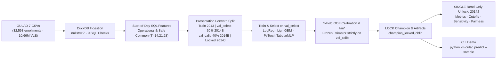
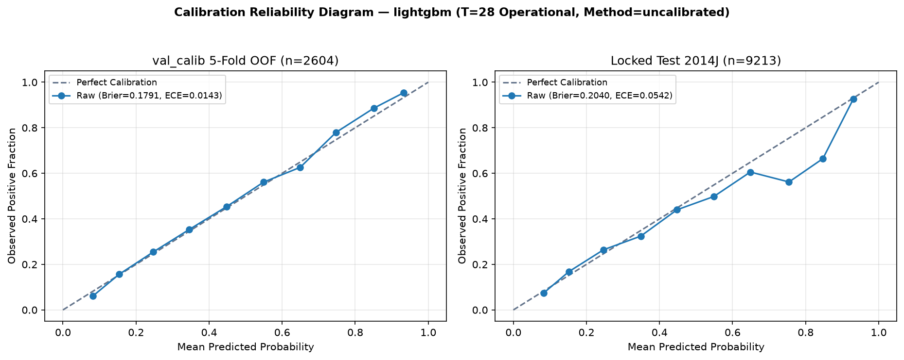

# OULAD Early Warning — Leakage-Free Student Risk Prediction

An end-to-end, reproducible tabular ML & PyTorch deep learning pipeline built on the **Open University Learning Analytics Dataset (OULAD, UCI ID 349, CC BY 4.0)** to identify students at risk of **Fail or Withdrawn** by **Day 28 (Start of Day)** with strict temporal leakage controls, explicit out-of-fold (OOF) calibration auditing, subgroup performance evaluation, and synthetic-database CI.

---

## 1. Problem Statement

Given a student enrollment `(code_module, code_presentation, id_student)` and only behavioral, assessment, and registration records strictly available **before Day $T$ (`< T`, Start-of-Day)** for $T \in \{14, 21, 28\}$, predict whether the student will end the course as **At-Risk** (`final_result IN {'Fail', 'Withdrawn'}`, `target = 1`) versus **On-Track** (`final_result IN {'Pass', 'Distinction'}`, `target = 0`).

## 2. Why It Matters

Online and blended university courses suffer high early attrition (`40.79%–48.43%` at-risk rate across OULAD presentations). Detecting risk **by Week 4 (Day 28)** — while students are still enrolled and intervention is actionable — allows academic advisors to prioritize supportive outreach rather than discovering failure at the end of the term. Equally important, early-warning pipelines are notoriously vulnerable to **silent temporal leakage** (late registrations, post-cutoff withdrawals, future assessment due dates, and random train/test splits); this project focuses on preventing, proving, and transparently documenting those failure modes.

## 3. System Architecture



## 4. Dataset & Data Quality Audit

- **Source & Attribution:** Kuzilek, J., Hlosta, M., & Zdrahal, Z. (2017). *Open University Learning Analytics dataset*, Scientific Data 4:170171. Licensed under **CC BY 4.0** (UCI ML Repository ID 349). Raw CSVs are gitignored; place the 7 files into `data/raw/`.
- **Ingested Scale (`reports/data_quality.json`):**
  - `studentInfo`: `32,593` rows · `studentRegistration`: `32,593` rows · `studentVle`: `10,655,280` rows · `studentAssessment`: `173,912` rows · `assessments`: `206` rows · `vle`: `6,364` rows · `courses`: `22` rows.
- **Automated SQL Data Quality (`9/9` checks = `0` violations):** composite primary key uniqueness, `final_result` domain, 3-key `studentVle → vle` referential integrity, `studentAssessment → assessments` integrity, valid score `[0, 100]`, positive `sum_click`, `vle.date <= module_presentation_length`, `imd_band` missing rate (`1,111 / 32,593 = 3.41% < 5%`), and `date_unregistration >= date_registration`.
- **Returning vs New Student Overlap:** `2014B` contains `12.34%` returning enrollments (`963 / 7,804`); `2014J` contains `8.87%` returning enrollments (`999 / 11,260`). Metrics are explicitly broken down by `Returning` vs `New`.

## 5. Methodology & Anti-Leakage Controls

1. **Start-of-Day Cohorts (`AUD-01`):**
   - **Operational Cohort (Primary):** `date_registration < T` AND `(date_unregistration IS NULL OR date_unregistration >= T)` (`T=14: 28,062`, `T=21: 27,880`, `T=28: 27,528`).
   - **Safe Common Cohort (Controlled Horizon Comparison):** `date_registration < 14` AND still enrolled at `T=28` (`27,491` enrollments across all 3 cutoffs).
2. **Leakage-Safe Feature Bounds (`AUD-02`):** Strictly `< T` for all VLE clicks and assessments (`submission_rate_due ∈ [0, 1]` using only assessments due `< T` and submitted `< T`; top-5 VLE activity types derived strictly from Train presentations `2013B+2013J`). Verified by **26 parameterized anti-leakage tests** (`test_leakage.py`) including future-event and post-outcome mutation invariance.
3. **Presentation-Based Forward Split (`AUD-07`):**
   - `train`: `2013B + 2013J` (`n = 11,806` at `T=28 Operational`)
   - `val_select`: `60%` stratified of `2014B` (`n = 3,905`) — model & hyperparameter selection, early stopping, SHAP
   - `val_calib`: `40%` stratified of `2014B` (`n = 2,604`, `pos_rate = 48.43%`) — explicit 5-fold OOF calibration & threshold selection
   - `test_locked`: `2014J` (`n = 9,213`, `pos_rate = 40.79%`) — unlocked **once, read-only** after locking all models (`post_unlock_model_edits = 0`).
   - *Calendar Overlap Disclosure:* `2013J` (Oct 2013–Jun 2014) overlaps ~4 months with `2014B` (Feb–Oct 2014), whereas `2013 → 2014J` (Oct 2014) has zero calendar overlap.
4. **Explicit 5-Fold OOF Calibration (`AUD-08`, `FA-02`):** Runs an explicit `StratifiedKFold(5)` loop with `CalibratedClassifierCV(estimator=FrozenEstimator(base_model))` (scikit-learn ≥ 1.6), enforces a hard guard blocking `isotonic` when `n_calib < 1000` or `min_fold_train < 800`, picks operating threshold `tau*` (`Precision >= 0.70`, `n_pred >= 30`, with deterministic `max_f1` fallback) on **OOF** probabilities, and fits the final calibrator on full `val_calib` before locking.

## 6. How to Run

### Environment Setup (CPU-Locked Reproducible Environment)
```bash
python -m venv .venv
# Windows PowerShell: .\.venv\Scripts\Activate.ps1
# Linux/macOS: source .venv/bin/activate
pip install --index-url https://pypi.org/simple --extra-index-url https://download.pytorch.org/whl/cpu -r requirements-cpu.lock
pip install --no-deps --no-build-isolation -e .
```
*(Platform lockfiles: `requirements-cpu.lock` pins CPU-only PyTorch wheels with 0 CUDA / 0 `@ file://` entries for CI; `requirements-local.lock` captures the local Windows workstation environment.)*

### Reproducible Pipeline & Sample Prediction Demo
```bash
# 1. Place the 7 OULAD CSV files (UCI ID 349, CC BY 4.0) into data/raw/
# 2. Dry-run verification of inputs and 5 pipeline stages (does not modify reports/):
python -m oulad.run_all --skip-download --dry-run

# 3. Full end-to-end reproduction (seed=42):
python -m oulad.run_all --skip-download

# 4. Run the locked-champion CLI demo with non-causal Top-5 SHAP drivers:
python -m oulad.predict --sample
```

## 7. How to Test

All automated checks run offline on synthetic DuckDB fixtures (zero raw dataset download required, zero GPU required):

```bash
ruff check .
pytest -v
```

Test suites cover:
- `tests/test_quality.py` (13 tests): 9 SQL data quality checks, `nullstr='?'` parsing, Returning/New overlap.
- `tests/test_leakage.py` (26 tests): parameterized `[14, 21, 28]` × `{operational, common}` future-event invariance, post-outcome invariance, registration/week bounds, `submission_rate_due ∈ [0, 1]`, train-only top activities.
- `tests/test_split_and_baselines.py` (6 tests): forward split invariants, `subsample_freq=1`, unseen categories, `2014J` mutation isolation.
- `tests/test_models.py` (4 tests): PyTorch `TabularMLP` `Unknown/Missing -> 0`, raw logits, gradient step, checkpoint roundtrip & `2014J` isolation.
- `tests/test_metrics.py` (10 tests): `n_calib < 1000` isotonic guard, `FrozenEstimator` 5-fold disjoint OOF audit & final refit, `2014J` calibration/threshold isolation, `max_f1` fallback, `AUD-B5-01` cost-ratio disclaimer, `min(20, len)` FP/FN, Fairness `low_sample_warning`.
- `tests/test_cli.py` (2 tests): `predict --sample` SHAP contract & isolated `run_all` dry-run / Stage 1–2 execution.

## 8. Verified Empirical Results (100% Traceable to `reports/`)

### 8.1 Validation (`val_select`, `T=28 Operational`, `n = 3,905`, `pos_rate = 48.43%`) & Locked Test (`2014J`, `n = 9,213`, `pos_rate = 40.79%`)

| Model | `val_select` PR-AUC / ROC-AUC / Brier | OOF Calib Choice (`tau*`) | Locked `2014J` PR-AUC | Locked `2014J` ROC-AUC | Locked `2014J` Raw → Final Brier (`Δ`) | Locked `2014J` Raw → Final ECE (`Δ`) | Locked `2014J` Prec / Rec / F1 |
| :--- | :---: | :---: | :---: | :---: | :---: | :---: | :---: |
| **LightGBM *(Champion)*** | **`0.7871` / `0.7842` / `0.1880`** | `uncalibrated` (`0.4279`) | **`0.6813`** | **`0.7467`** | `0.2040 → 0.2040` (`0.0000`) | `0.0542 → 0.0542` (`0.0000`) | `0.6023 / 0.6852 / 0.6411` |
| **TabularMLP (PyTorch, CPU)** | `0.7695` / `0.7689` / `0.1955` | `sigmoid` (`0.4156`) | `0.6376` | `0.7221` | `0.2128 → 0.2186` (`+0.0058`) | `0.0532 → 0.0713` (`+0.0181`) | `0.6022 / 0.6408 / 0.6209` |
| **LogisticRegression** | `0.7815` / `0.7791` / `0.1911` | `sigmoid` (`0.4398`) | `0.6184` | `0.7239` | `0.2180 → 0.2187` (`+0.0007`) | `0.0814 → 0.0812` (`-0.0002`) | `0.6132 / 0.6437 / 0.6281` |

*Source:* [reports/metrics_val.json](reports/metrics_val.json) & [reports/metrics_test_locked.json](reports/metrics_test_locked.json).
- **Calibration Note (`AUD-B5-02` & `FA-07`):** Brier Score combines discrimination, calibration, and uncertainty — lower Brier does **not** automatically imply better calibration. LightGBM was kept `uncalibrated` strictly by the pre-specified OOF Brier selection rule on `val_calib` (`0.17912` raw vs `0.18011` sigmoid vs `0.18064` isotonic). Under the `-7.64 pp` seasonal prior shift (`2014B` `48.43%` → `2014J` `40.79%`), LightGBM's locked `2014J` ECE is `0.0542` (not perfectly calibrated), and `sigmoid` calibrators fitted on `2014B` slightly degraded Brier on `2014J`.

### 8.2 Cutoff Horizon Comparison on Locked Test `2014J` ([reports/cutoff_comparison_test.csv](reports/cutoff_comparison_test.csv))

| Cohort Mode | Cutoff (`T`) | `n_test` | LogReg PR-AUC / ROC-AUC | LightGBM PR-AUC / ROC-AUC / Brier |
| :--- | :---: | :---: | :---: | :---: |
| Operational | Day 14 | `9,332` | `0.6137` / `0.7049` | `0.6312` / `0.7053` / `0.2127` |
| Operational | Day 21 | `9,291` | `0.6110` / `0.7120` | `0.6526` / `0.7205` / `0.2148` |
| Operational *(Primary)* | Day 28 | `9,213` | `0.6184` / `0.7239` | **`0.6813` / `0.7467` / `0.2040`** |
| Safe Common | Day 14 | `9,192` | `0.6070` / `0.7050` | `0.6239` / `0.7058` / `0.2109` |
| Safe Common | Day 21 | `9,192` | `0.6009` / `0.7103` | `0.6501` / `0.7227` / `0.2125` |
| Safe Common | Day 28 | `9,192` | `0.6190` / `0.7239` | `0.6798` / `0.7491` / `0.2028` |

### 8.3 Returning vs New, Sensitivity Checks & Illustrative Cost–Benefit (`2014J`, LightGBM)

- **Returning vs New (`2014J`):** Returning (`n = 782`, `8.49%`, `pos_rate = 57.93%`): `PR-AUC = 0.7987`, `ROC-AUC = 0.7442`, `Brier = 0.2037`; New (`n = 8,431`, `91.51%`, `pos_rate = 39.20%`): `PR-AUC = 0.6640`, `ROC-AUC = 0.7428`, `Brier = 0.2040`.
- **Sensitive-Demographic Ablation** *(drop `gender`, `disability`, `imd_band`)*: `PR-AUC = 0.6799 (-0.0014)`, `ROC-AUC = 0.7466 (-0.0001)` — does **not** certify fairness due to proxy features (`AUD-B5-03`).
- **Score-Free Sensitivity Check (`FA-03`, `AUD-B5-04`)** *(drop `mean_score`, `has_score`)*: `PR-AUC = 0.7008 (+0.0195)`, `ROC-AUC = 0.7525 (+0.0058)`, `Brier = 0.1948` on `2014J`. Recorded strictly as an **exploratory post-unlock finding**; Full LightGBM remains the locked champion (`FA-02`).
- **Illustrative Cost–Benefit (`AUD-B5-01`):** Under illustrative assumptions only (not real institutional costs), at `FP:FN = 1:5`, locked `tau* = 0.4279` yields `FP=1,700, FN=1,183` (cost `7,615` / `0.8265` per student) vs fixed cost-ratio cutoff `0.1667` (`FP=4,216, FN=180`, cost `5,116` / `0.5553`). At `1:10`, locked `tau*` yields cost `13,530` (`1.4686`) vs fixed cutoff `0.0909` (`FP=5,247, FN=12`, cost `5,367` / `0.5825`). Because the champion outputs raw uncalibrated scores, `C_FP/(C_FP+C_FN)` is **not** claimed to be Bayes-optimal.

### 8.4 Diagnostic Figures

| Global Predictive Attribution (Non-Causal SHAP, `val_select`) | Reliability Diagram (`val_calib OOF` vs Locked `2014J`) |
| :---: | :---: |
|  |  |

*(PyTorch `TabularMLP` training/validation learning curve: [reports/figures/learning_curve.png](reports/figures/learning_curve.png). Full subgroup performance audit: [reports/fairness_test.csv](reports/fairness_test.csv) and [MODEL_CARD.md](MODEL_CARD.md).)*

## 9. Limitations & Caveats

1. **Seasonal Prior Shift (`FA-07`):** Calibration and operating threshold selected on February cohort `2014B` (`48.43%` at-risk) shifted on October cohort `2014J` (`40.79%` at-risk), dropping Precision from `0.7011` (`val_calib OOF`) to `0.6023` (`2014J`) with `ECE = 0.0542`.
2. **Missing `date_graded` in OULAD (`FA-03`):** OULAD records `date_submitted` and `score`, not grading release timestamps; `mean_score` also exhibited cross-season instability on `2014J`.
3. **Subgroup Performance Disparities (`AUD-B5-03`):** Observational audit across 18 subgroups (`reports/fairness_test.csv`) shows notable Recall/FPR gaps (e.g., `gender F` Recall `0.6161` vs `M` `0.7306`; `imd_band 0-10%` FPR `0.4351` vs `90-100%` `0.2244`). This audit is **not** a fairness certification.
4. **Irreducible Post-Day-28 Shocks:** Post-lock error analysis (`20` FP, `20` FN sampled via `min(20, len)`) confirms high-performing Day-28 students (`mean_score = 90–100`) still drop out due to mid/late-term life shocks invisible at Day 28.
5. **Non-Causal Explanations & CPU Execution:** SHAP reflects predictive reliance, not causal intervention effect; `TabularMLP` was executed on CPU fallback (`device_used = "cpu"`, no GPU training claimed).

## 10. Future Improvements

- Validate **Score-Free vs Full feature sets** and **season-matched recalibration** (`B→B`, `J→J`) on a **fresh, unused holdout cohort** (never re-tuning on `2014J`).
- Add **bootstrap 95% confidence intervals** for locked metrics and subgroup Recall/FPR gaps, plus **PSI drift monitoring** across incoming terms.
- Explore sequence models (`WeeklyClickGRU`) over daily/weekly VLE trajectories on a separate experimental branch after Release Candidate freeze.

---

See [MODEL_CARD.md](MODEL_CARD.md) for full intended/prohibited use, ethical risks, and detailed audit disclosures.
