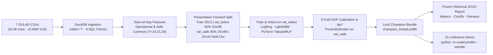
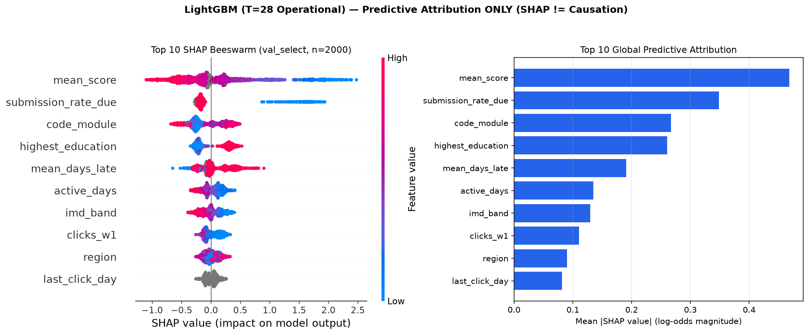

# OULAD Early Warning — Leakage-Free Student Risk Prediction

[](https://github.com/Fairy3425/oulad-early-warning/actions/workflows/ci.yml)

An end-to-end, reproducible tabular ML and PyTorch pipeline on the **Open University Learning Analytics Dataset (OULAD, UCI ID 349, CC BY 4.0)** that predicts whether an active student is at risk of **Fail or Withdrawn** by **Day 28 (Start of Day)** — built to prioritize supportive academic advising while rigorously preventing temporal data leakage.

## Highlights

| Pillar | Verified Outcome | Evidence |
| :--- | :--- | :--- |
| **Data Engineering & SQL Quality** | Ingests `32,593` enrollments & `10.66M` VLE logs in DuckDB (`nullstr='?'`); `9/9` automated SQL quality checks pass (`0` violations). | [data_quality.json](reports/data_quality.json) |
| **Proven Anti-Leakage Controls** | Start-of-Day `< T` features (`T ∈ {14, 21, 28}`), bounded `submission_rate_due ∈ [0, 1]`, and `29` parameterized leakage tests (`Operational` vs `Safe Common`). | [test_leakage.py](tests/test_leakage.py) |
| **3-Model Benchmark (ML + PyTorch)** | LightGBM outperforms Logistic Regression and PyTorch `TabularMLP` on validation (`PR-AUC 0.7871`) and frozen historical `2014J` (`PR-AUC 0.6813`, `ROC-AUC 0.7467`). | [metrics_val.json](reports/metrics_val.json), [metrics_test_locked.json](reports/metrics_test_locked.json) |
| **Calibration & Subgroup Audit** | Explicit 5-fold OOF calibration (`FrozenEstimator`) on `val_calib`, honest seasonal shift reporting (`ECE 0.0542`), non-causal SHAP, and 18-subgroup performance audit. | [fairness_test.csv](reports/fairness_test.csv), [MODEL_CARD.md](MODEL_CARD.md) |
| **Reproducibility & CI** | `86/86` offline synthetic-DB tests, `ruff` 0 errors, pinned Linux CPU lockfile (`0` CUDA), safe-by-default CLI, and green GitHub Actions CI. | [ci.yml](.github/workflows/ci.yml), [REPRODUCIBILITY.md](docs/REPRODUCIBILITY.md) |

## Table of Contents

- [1. Project Overview](#1-project-overview)
- [2. Dataset](#2-dataset)
- [3. Methodology](#3-methodology)
- [4. Results](#4-results)
- [5. Quick Start](#5-quick-start)
- [6. Notebooks & Project Structure](#6-notebooks--project-structure)
- [7. Limitations & Future Work](#7-limitations--future-work)
- [8. Documentation & References](#8-documentation--references)

---

## 1. Project Overview

- **Problem:** Online university courses experience high attrition (`44.14%` overall at-risk rate in the Day-28 Operational cohort; `48.43%` in `2014B` and `40.79%` in `2014J`). Discovering risk at course completion is too late for intervention, yet building early-warning models is notoriously prone to silent temporal leakage (late registrations, future withdrawals, upcoming due dates, or random splits).
- **Objective:** Given a student enrollment `(code_module, code_presentation, id_student)` and only records strictly available **before Day $T$** ($T \in \{14, 21, 28\}$, primary horizon **$T = 28$**), predict binary risk (`Fail` or `Withdrawn` → `1` vs `Pass` or `Distinction` → `0`) to support **voluntary, non-punitive academic outreach** (never automated penalties).

---

## 2. Dataset

- **Source:** Open University Learning Analytics Dataset (Kuzilek et al., 2017, *Scientific Data*, UCI ML Repository ID 349, licensed **CC BY 4.0**). Raw CSVs are gitignored; place the 7 files into `data/raw/`.
- **Scale (`reports/data_quality.json`):** `32,593` student enrollments across `22` module-presentations (`AAA`–`GGG` × `2013B/2013J/2014B/2014J`), `10,655,280` daily VLE click logs, and `173,912` assessment submissions.
- **Key Features (strictly `< T`):**
  1. *VLE activity:* pre-course and weekly clicks, active days, unique resources, click volatility, recency (`days_since_last_click`), and Train-only top-5 activity types.
  2. *Assessments:* bounded due-assessment submission rate (`submission_rate_due ∈ [0, 1]`), separate early/banked counts, `mean_score`, and submission lateness.
  3. *Enrollment & demographics:* module, registration day (`< T`), prior attempts, credits, education, region, age band, disability, and deprivation index (`imd_band`, `3.41%` missing preserved explicitly).
- **Data Constraints:** OULAD does not provide `date_graded` timestamps (tested via a score-free sensitivity check), and returning students across terms (`12.34%` in `2014B`, `8.87%` in `2014J`) are tracked as a dedicated segment rather than dropped.

---

## 3. Methodology



1. **Leakage-Free Cohorts:** Primary results use the **Operational Cohort** (`date_registration < T` and still enrolled at Day $T$), training separate models per horizon `14 / 21 / 28`. A **Safe Common Cohort** (`date_registration < 14`, still enrolled at Day 28) is evaluated solely as a retrospective sensitivity check.
2. **Presentation-Based Forward Split:** Train on `2013B + 2013J` (`n = 11,806`), stratify `2014B` `60/40` into `val_select` (`n = 3,905`) and `val_calib` (`n = 2,604`), and hold out `2014J` (`n = 9,213`). *Calendar disclosure:* `2013J` (Oct 2013–Jun 2014) overlaps ~4 months with `2014B` (Feb–Oct 2014), whereas `2013 → 2014J` (Oct 2014) has zero calendar overlap.
3. **Three Benchmarked Models:** Logistic Regression (standard sklearn pipeline), LightGBM (`subsample_freq=1` row bagging, early stopping on `val_select`), and PyTorch `TabularMLP` (entity embeddings with `Unknown/Missing = 0`, LayerNorm, Dropout `0.2`, unweighted `BCEWithLogitsLoss`, trained on CPU).
4. **Explicit 5-Fold OOF Calibration & Thresholding:** Compares `uncalibrated`, `sigmoid`, and `isotonic` (with an automatic guard blocking `isotonic` if `n_calib < 1000`) via explicit 5-fold `StratifiedKFold` + `FrozenEstimator` strictly on `val_calib`, then selects `tau*` (`Precision >= 0.70`, `n_pred >= 30`, deterministic `max_f1` fallback) on OOF probabilities before locking.

Full SQL rules, 12-cutoff benchmarks, sensitivity checks, and illustrative cost–benefit tables are documented in [docs/METHODOLOGY_AND_EVALUATION.md](docs/METHODOLOGY_AND_EVALUATION.md).

---

## 4. Results

### Primary Comparison (`T = 28 Operational`)

| Model | Validation `val_select` (`2014B`, `n=3,905`) PR-AUC / ROC-AUC / Brier | OOF Calib Choice (`val_calib`, `tau*`) | Frozen Historical `2014J` (`n=9,213`) PR-AUC / ROC-AUC | Frozen `2014J` Raw → Final Brier (`Δ`) | Frozen `2014J` Raw → Final ECE (`Δ`) | Frozen `2014J` Prec / Rec / F1 |
| :--- | :---: | :---: | :---: | :---: | :---: | :---: |
| **LightGBM *(Champion)*** | **`0.7871` / `0.7842` / `0.1880`** | `uncalibrated` (`0.4279`) | **`0.6813` / `0.7467`** | `0.2040 → 0.2040` (`0.0000`) | `0.0542 → 0.0542` (`0.0000`) | `0.6023 / 0.6852 / 0.6411` |
| **TabularMLP (PyTorch, CPU)** | `0.7695` / `0.7689` / `0.1955` | `sigmoid` (`0.4156`) | `0.6376` / `0.7221` | `0.2128 → 0.2186` (`+0.0058`) | `0.0532 → 0.0713` (`+0.0181`) | `0.6022 / 0.6408 / 0.6209` |
| **Logistic Regression** | `0.7815` / `0.7791` / `0.1911` | `sigmoid` (`0.4398`) | `0.6184` / `0.7239` | `0.2180 → 0.2187` (`+0.0007`) | `0.0814 → 0.0812` (`-0.0002`) | `0.6132 / 0.6437 / 0.6281` |

> **Evaluation Context & Provenance Note:**
> - **Validation results (`val_select` & `val_calib`)** come from [reports/metrics_val.json](reports/metrics_val.json) and [reports/metrics_test_locked.json](reports/metrics_test_locked.json) (`val_calib` `48.43%` positive rate).
> - **Frozen Historical `2014J` results** (`40.79%` positive rate) come from [reports/metrics_test_locked.json](reports/metrics_test_locked.json), originally committed in `0dc75f2` and unchanged across subsequent Git history. `2014J` was excluded from training, model selection, calibration, and thresholding; however, repository history alone does not independently certify the exact number of local runs before `0dc75f2`, so `2014J` is reported transparently as a **frozen historical evaluation** rather than a freshly verified blind test.
> - **Post-hoc reproduction** via `--include-locked-test` is disabled by default and is strictly a historical reproduction (see [docs/REPRODUCIBILITY.md](docs/REPRODUCIBILITY.md)).

### Diagnostic Figures

| Global Predictive Attribution (Non-Causal SHAP, `val_select`) | Reliability Diagram (`val_calib OOF` vs Frozen `2014J`) |
| :---: | :---: |
|  |  |

*(PyTorch training curve: [reports/figures/learning_curve.png](reports/figures/learning_curve.png). Full 18-subgroup audit: [reports/fairness_test.csv](reports/fairness_test.csv) & [MODEL_CARD.md](MODEL_CARD.md).)*

### Key Findings

- **Seasonal prior shift degrades threshold & probability transfer:** Moving from February `2014B` (`48.43%` at-risk) to October `2014J` (`40.79%` at-risk, `-7.64 pp`) dropped LightGBM Precision from `0.7011` (`val_calib OOF`) to `0.6023` (`2014J`) with `ECE = 0.0542`, and `2014B`-fitted `sigmoid` calibrators slightly increased `2014J` Brier scores.
- **Signal improves monotonically across horizons:** On frozen `2014J` Operational cohorts ([reports/cutoff_comparison_test.csv](reports/cutoff_comparison_test.csv)), LightGBM `PR-AUC` rises from `0.6312` (Day 14) → `0.6526` (Day 21) → `0.6813` (Day 28).
- **Sensitivity checks reinforce caution:** Dropping `gender`, `disability`, and `imd_band` changed `2014J` `PR-AUC` by only `-0.0014` (`0.6799`), confirming proxy variables persist. Dropping `mean_score` and `has_score` (testing the missing `date_graded` assumption) reduced `val_select` `PR-AUC` (`-0.0301`) but yielded `0.7008` (`+0.0195`) on `2014J` — logged strictly as an exploratory finding without changing the locked champion.

---

## 5. Quick Start

### Option A — Run Offline Verification & Tests (No Dataset Download Required)

```bash
# Linux x86_64 · Python 3.11 · CPU (CI-verified environment)
python3.11 -m venv .venv
source .venv/bin/activate
pip install --index-url https://pypi.org/simple --extra-index-url https://download.pytorch.org/whl/cpu -r requirements-cpu.lock
pip install --no-deps --no-build-isolation -e .

ruff check .
pytest -q
```

Runs `86` offline tests across `6` test modules (`7` Python files in `tests/`) using synthetic DuckDB fixtures.

### Option B — Safe Fresh-Clone Pipeline & CLI Demo (Default Skips `2014J` Evaluation)

1. Download the 7 OULAD CSV files (UCI ID 349, CC BY 4.0) into `data/raw/`.
2. Build DuckDB, 6 feature Parquets, validation models, and `artifacts/champion_locked.joblib` **without running Stage 5 (`2014J` evaluation)**:
   ```bash
   python -m oulad.run_all --skip-download --skip-locked-test
   ```
3. Run the CLI inference demo on **two synthetic illustrative Day-28 student profiles** *(not real students and never read from `2014J`)*:
   ```bash
   python -m oulad.predict --sample
   ```

**Verified sample output (synthetic illustrative profiles):**
```text
Champion Model    : lightgbm (T=28 operational)
Calibration Method: uncalibrated | Locked Threshold tau*: 0.4279

[demo_high_risk] risk_score=0.9571 (raw_uncalibrated_model_score) vs tau*=0.4279 -> AT_RISK_ALERT
  Top 5 SHAP predictive drivers (non-causal):
    1. submission_rate_due = 0.0 (+1.5677 log-odds, increases_risk)
    2. mean_score = None (+0.2924 log-odds, increases_risk)
    3. highest_education = Lower Than A Level (+0.2765 log-odds, increases_risk)
    4. code_module = DDD (+0.1657 log-odds, increases_risk)
    5. imd_band = 10-20 (+0.1526 log-odds, increases_risk)

[demo_low_risk] risk_score=0.1144 (raw_uncalibrated_model_score) vs tau*=0.4279 -> NO_ALERT
  Top 5 SHAP predictive drivers (non-causal):
    1. mean_score = 84.0 (-0.3389 log-odds, decreases_risk)
    2. code_module = BBB (-0.2878 log-odds, decreases_risk)
    3. highest_education = HE Qualification (-0.2251 log-odds, decreases_risk)
    4. submission_rate_due = 1.0 (-0.1828 log-odds, decreases_risk)
    5. mean_days_late = -2.0 (-0.1750 log-odds, decreases_risk)
```

For environment notes (`requirements-cpu.lock` vs `requirements-local.lock`), exact `2014J` data-access boundaries, and opt-in post-hoc historical reproduction (`--include-locked-test`), see [docs/REPRODUCIBILITY.md](docs/REPRODUCIBILITY.md).

---

## 6. Notebooks & Project Structure

### Executed Notebooks (Saved Outputs & Figures)

| Notebook | Purpose & Saved Evidence |
| :--- | :--- |
| [01_duckdb_quality_and_overlap.ipynb](notebooks/01_duckdb_quality_and_overlap.ipynb) | DuckDB load (`32.6k` / `10.66M`), 9 SQL quality checks, Returning vs. New overlap |
| [02_features_leakage_and_cutoffs.ipynb](notebooks/02_features_leakage_and_cutoffs.ipynb) | Export of 6 Parquets (`14/21/28` × `Op/Common`) + direct real-data anti-leakage checks |
| [03_modeling_and_shap.ipynb](notebooks/03_modeling_and_shap.ipynb) | Forward split, LogReg & LightGBM baselines, 12 cutoffs, sensitivity checks, embedded SHAP plot |
| [04_tabular_mlp_and_ci.ipynb](notebooks/04_tabular_mlp_and_ci.ipynb) | PyTorch `TabularMLP` training summary, 3-model `val_select` table, embedded learning curve |
| [05_calibration_locked_test_and_fairness.ipynb](notebooks/05_calibration_locked_test_and_fairness.ipynb) | Read-only audit of frozen `2014J` report: OOF calibration, metrics, cutoffs, fairness & reliability curve |

### Repository Tree

```text
oulad-early-warning/
├── .github/workflows/ci.yml        # GitHub Actions CI (Linux CPU lockfile, ruff + pytest)
├── README.md                       # Project overview, headline results & quick start
├── MODEL_CARD.md                   # Intended/prohibited use, fairness audit & ethical risks
├── docs/                           # Deep-dive methodology & reproducibility documentation
│   ├── METHODOLOGY_AND_EVALUATION.md
│   └── REPRODUCIBILITY.md
├── notebooks/                      # 5 executed Jupyter notebooks (01..05)
├── reports/                        # Verified JSON/CSV outputs & 3 diagnostic PNG figures
├── src/oulad/                      # Installable Python package (11 modules: DB → FE → ML/DL → Eval → CLI)
├── tests/                          # Offline synthetic-DB test suite (conftest.py + 6 modules, 86 tests)
├── pyproject.toml                  # src/ package layout, pytest pythonpath & ruff config
├── requirements-cpu.{in,lock}      # Linux x86_64 Python 3.11 CPU dependencies (CI target)
└── requirements-local.lock         # Windows workstation provenance snapshot (non-portable)
```

*(Gitignored runtime directories: `data/`, `artifacts/`, `mlflow.db`, `.venv/`.)*

---

## 7. Limitations & Future Work

- **Limitations:**
  1. *Seasonal prior shift:* Calibrators and thresholds tuned on February `2014B` shift under October `2014J` priors (`ECE = 0.0542`, Precision `0.7011 → 0.6023`).
  2. *Missing `date_graded`:* OULAD records submission timestamps and scores but not grading release times; real-world deployments must verify LMS grade-release availability before Day 28.
  3. *Subgroup disparities:* Observational audit ([reports/fairness_test.csv](reports/fairness_test.csv)) reveals meaningful Recall/FPR gaps (e.g., `gender F` Recall `0.6161` vs `M` `0.7306`; `imd_band 0-10%` FPR `0.4351` vs `90-100%` `0.2244`). This is an audit, not a fairness certification.
  4. *Post-Day-28 life shocks & non-causal SHAP:* High-performing Day-28 learners (`mean_score = 90–100`) still withdraw due to later-term events invisible at Day 28; SHAP reflects predictive reliance, not causal intervention effect.
- **Proposed Future Improvements *(not yet implemented)*:**
  - Validate score-free vs. full features and season-matched recalibration (`B→B`, `J→J`) on a fresh, unused holdout cohort.
  - Add bootstrap 95% confidence intervals for locked and subgroup metrics plus PSI drift monitoring across terms.
  - Evaluate sequence models (e.g., weekly click GRU) on a separate experimental branch.

---

## 8. Documentation & References

- **Project Documentation:** [MODEL_CARD.md](MODEL_CARD.md) · [docs/METHODOLOGY_AND_EVALUATION.md](docs/METHODOLOGY_AND_EVALUATION.md) · [docs/REPRODUCIBILITY.md](docs/REPRODUCIBILITY.md)
- **Dataset Reference:** Kuzilek, J., Hlosta, M., & Zdrahal, Z. (2017). *Open University Learning Analytics dataset*. Scientific Data, 4:170171. [UCI ML Repository ID 349](https://archive.ics.uci.edu/dataset/349/open+university+learning+analytics+dataset) — licensed under **CC BY 4.0**.
- **Licensing Note:** OULAD raw data is governed by **CC BY 4.0** (not redistributed in this repository). Source code licensing for this repository has not yet been finalized in a standalone `LICENSE` file.
